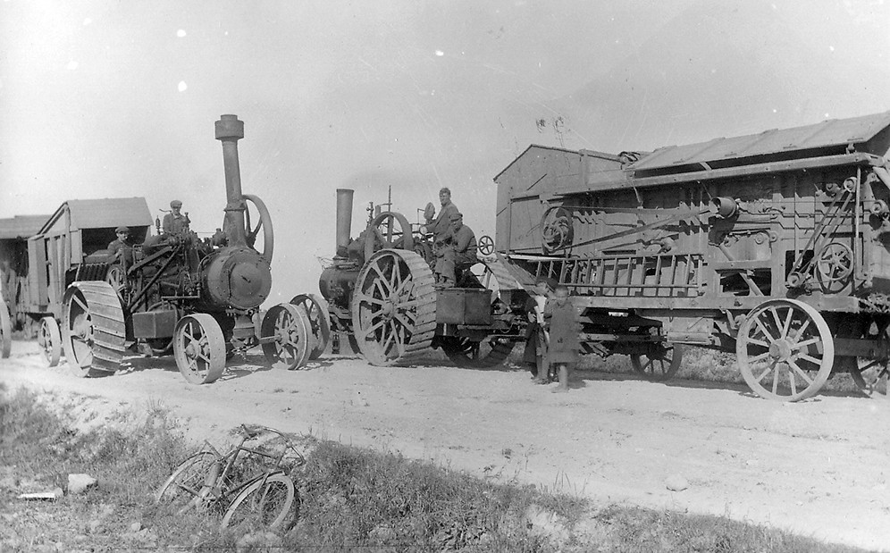

# traction-engine



*Steam engine tractors with threshing machines, Latvia, 1930s. Photo: [Valters Grivins](https://www.flickr.com/photos/59344280@N08/6447495201/), [CC BY 2.0](https://creativecommons.org/licenses/by/2.0/).*

A job-posting triage pipeline: give it a posting, get back what the employer is really looking for (must-haves, nice-to-haves, seniority, terms, comp) as structured data.

I keep the data and fiddle with it for trend analysis.

It's also an experiment in operating an LLM tool for 30 days and writing down what breaks. That log is unsurprisingly in [breaks.md](breaks.md).

## Why

An AI auto-apply service sent 400-600 applications on my behalf over two months. Result: 2-3 interviews. But I landed dozens (sigh) of interviews through other sources. The job offers only came through recruiters. Volume doesn't work; picking the few postings worth real effort does. Hopefully this is the picking part.

The task has a fixed shape, so it's a pipeline: each step is small, testable, and evaluable on its own.

## Status

M1 (extraction) is working. Started 2026-10-27 with a backfill over a year of saved postings: 95 postings, zero failures, and either $0.10 or $0.18 depending on which OpenRouter number you believe (see [breaks.md](breaks.md)). Matching against my skills, the eval set, and retrieval come next, in that order. Design: [docs/specs/2026-10-23-traction-engine-design.md](docs/specs/2026-10-23-traction-engine-design.md).

## Usage

Needs [uv](https://docs.astral.sh/uv/) and an [OpenRouter](https://openrouter.ai/) key, either in `OPENROUTER_API_KEY` or in the macOS Keychain under the service named in `config.yaml`.

```bash
uv sync
uv run triage samples/2026.01.05.northwind-insurance.staff-ai-engineer.md   # one posting
uv run triage --backfill samples                                          # a directory
uv run triage --summary                                                   # counts across everything extracted
uv run pytest                                                             # unit tests, no API calls
```

Each posting gets a Markdown report and a JSON record in `reports/`. The repo ships three synthetic postings in `samples/`, one of them a prompt-injection attempt. Real postings stay private: `config.local.yaml` (gitignored) points at them.

## How it works

- **One wrapper for every LLM call** (`llm.py`, about 100 lines, hand-written on purpose). It logs tokens, cost, and latency to `calls.jsonl`, and refuses to call once the day's spend hits the cap in `config.yaml`. Cost is the charge OpenRouter reports on each response (which doesn't always agree with their dashboard).
- **Structured output, validated after logging.** The model returns JSON against a Pydantic schema; a billed call that fails validation is still logged before it fails. One retry with the error fed back.
- **Postings are untrusted input.** They're delimited as data, the call has no tools, and the output is schema-only.
- **Either/or requirements stay either/or.** "React or Vue" is one requirement with two acceptable options, so the summary can tell "required" from "accepted".
- **Two cohorts.** The backfill archive was written by hand for me to read; live postings arrive verbatim. They're tagged separately, because numbers from one don't predict the other.

Model: Claude Haiku 5.5, via OpenRouter, at low effort. About a tenth of a cent per posting.

## What it isn't

No web UI, no database, no scraping, no cover letters, no multi-agent anything.
